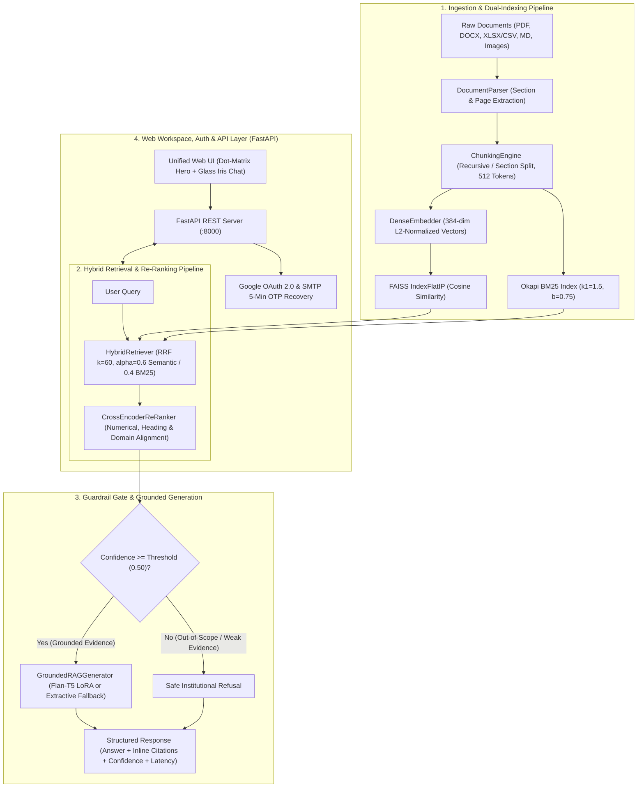

<div align="center">

# Kryon — Academic Regulations & Syllabus RAG Assistant

**Zero-hallucination, citation-backed Retrieval-Augmented Generation (RAG) system for university academic regulations, examination codes, and course syllabi.**

*Fully self-hosted · Hybrid FAISS + Okapi BM25 Retrieval · Cross-Encoder Re-Ranking · LoRA Fine-Tuned `Flan-T5` · Docker Ready*

</div>

---

## Overview

**Kryon** is an end-to-end, self-hosted question-answering platform engineered for high-stakes academic policy and curriculum documents where fabricated answers are unacceptable. Rather than relying on unconstrained external LLM APIs, Kryon enforces strict **evidence grounding**: every response is synthesized from verified institutional documents and backed by inline source citations (`[Source: document, §Section, Page N]`).

When retrieved evidence falls below a calibrated confidence threshold, Kryon's **Refusal Gate** explicitly declines out-of-scope or unsupported queries (such as campus dining, hostel rules, or unrelated trivia) instead of guessing.

### Core Capabilities

- **Multi-Format Document Ingestion**: Parses `.md`, `.markdown`, `.txt`, `.pdf`, `.docx`/`.doc`, `.xlsx`/`.xls`, `.csv`/`.tsv`, `.json`, and image files (`.png`, `.jpg`, `.jpeg`, `.webp`, `.bmp`, `.tiff`), with automatic directory rescanning on upload, edit, or deletion.
- **Hybrid Two-Stage Retrieval**: Combines **FAISS** (`IndexFlatIP`) 384-dimensional dense semantic search with **Okapi BM25** lexical matching via **Reciprocal Rank Fusion (RRF)** so both natural-language questions and exact rule numbers, course codes, or numeric thresholds are retrieved accurately.
- **Domain-Aware Cross-Encoder Re-Ranking**: Re-scores candidate chunks using query-term overlap, section-heading alignment, numerical constraint matching (e.g., `75%`, `160 credits`, CGPA cutoffs), and academic domain heuristics.
- **Zero-Hallucination Refusal Gate**: Blocks generation and returns a transparent institutional refusal whenever confidence drops below `CONFIDENCE_THRESHOLD` (default `0.50`).
- **Fine-Tuned Academic T5 + Extractive Fallback**: Synthesizes concise answers using a **LoRA fine-tuned `google/flan-t5-base`** model (`kryon-academic-t5`), and automatically falls back to deterministic grounded extraction when local model weights are absent.
- **Verified Access & Web Workspace**: Includes a light-mode (`#f7f7f5`) interactive landing & Glass Iris chat interface, **Google OAuth 2.0** sign-in, and **5-minute SMTP OTP** password recovery.

---

## System Architecture

Kryon separates **document ingestion & dual indexing** from the **real-time hybrid retrieval, re-ranking, confidence gating, and grounded synthesis** pipeline, served behind a unified FastAPI application.



### Architecture Breakdown

1. **Multi-Format Parsing & Structure-Aware Chunking**
   - `DocumentParser` extracts clean text, preserves section headings and estimated page numbers, and computes SHA-256 document hashes.
   - `ChunkingEngine` splits documents (`512` tokens with `50`-token overlap by default) while attaching document titles, filenames, section headings, and page metadata to every `TextChunk` for downstream citation tracking.
   - A directory sync check (`sync_if_needed`) detects files added, updated, or deleted in `data/raw/` and rebuilds indices automatically.

2. **Hybrid Vector + Lexical Retrieval (`FAISSVectorStore` + `BM25Retriever`)**
   - **Dense Semantic Branch**: Encodes queries and chunks into 384-dimensional L2-normalized vectors indexed in `faiss.IndexFlatIP` for exact cosine similarity scoring (supporting offline deterministic projections as well as local Ollama connections).
   - **Lexical Branch**: Builds an Okapi BM25 index (`k1=1.5`, `b=0.75`) over tokenized chunk text and section headings to catch exact policy identifiers, fees, percentages, and course codes.
   - **Reciprocal Rank Fusion (`HybridRetriever`)**: Merges the top semantic and lexical candidate lists using `k=60` and `alpha=0.6` (`60%` semantic, `40%` BM25) weighted fusion.

3. **Numerical & Domain Re-Ranking (`CrossEncoderReRanker`)**
   - Re-evaluates top candidates by weighting exact numerical matches (`%`, credits, marks), query-to-heading relevance, and domain signals (attendance condonation, CGPA classification/probation, internal/ESE marks, exam malpractice, laboratory rules) to calibrate final retrieval confidence.

4. **Confidence Gating & Grounded Generation (`GroundedRAGGenerator`)**
   - Enforces the configurable `CONFIDENCE_THRESHOLD` (`0.50` default). Queries failing the threshold trigger a safe policy refusal rather than unverified text generation.
   - Passing queries pass top-ranked context (`max_context_chars=1200`) to `kryon-academic-t5` (`google/flan-t5-base` with LoRA adapters), or fall back cleanly to extractive policy synthesis if weights are not mounted, returning answer text, structured citations, retrieved passage traces, confidence score, and execution latency.

---

## Tech Stack

| Layer | Technologies |
|---|---|
| **Backend & API** | Python 3.11, FastAPI, Uvicorn, Pydantic v2, `httpx`, `python-dotenv` |
| **Vector Search & IR** | `faiss-cpu` (`IndexFlatIP`), Okapi BM25, Reciprocal Rank Fusion, NumPy, SciPy |
| **ML & Fine-Tuning** | PyTorch (CPU/CUDA), Hugging Face `transformers` (`google/flan-t5-base`), `peft` (LoRA), `safetensors`, `accelerate`, `sentencepiece` |
| **Document Processing** | Standard parsers + Pillow (`.png`/`.jpg`/`.webp`/`.tiff` + PDF/DOCX/XLSX/CSV/MD) |
| **Authentication** | Google OAuth 2.0 (`httpx` token & userinfo exchange), SMTP TLS 6-digit OTP (`5`-minute TTL) |
| **Deployment** | Docker (`python:3.11-slim`), Docker Compose |

---

## How to Clone & Run

### Prerequisites

Choose **one** of the following setups:
- **Docker** *(Recommended — zero Python dependency setup)*: [Docker Desktop](https://www.docker.com/products/docker-desktop/) (includes Docker Compose).
- **Local Python**: Python `3.11+` and `pip`.

---

### Step 1: Clone the Repository

```bash
git clone https://github.com/biswa16-dev/Kryon.git
cd Kryon
```

### Step 2: Configure Environment *(Optional)*

Kryon works immediately with default settings and **does not require any external API keys**.  
If you want to customize retrieval defaults or enable **Google OAuth 2.0** and **SMTP OTP password reset**, copy the provided template:

```bash
# macOS / Linux / Git Bash
cp .env.example .env

# Windows PowerShell
Copy-Item .env.example .env
```

Edit `.env` only if you are adding optional SMTP or Google OAuth credentials (see [Configuration](#-configuration)).

---

### Option A: Run with Docker Compose *(Recommended)*

Build the image and launch the container in the background (mounts `./data/raw` and `./models`, loads `.env` if present, and binds port `8000`):

```bash
docker compose up -d --build
```

Useful management commands:
```bash
docker compose logs -f       # Stream container logs
docker compose stop          # Stop container (keeps container & image)
docker compose start         # Restart stopped container
docker compose down          # Stop and remove container
```

### Option B: Run with Standalone Docker

```bash
# 1. Build the CPU-optimized image
docker build -t kryon-rag .

# 2. Run the container (add `--env-file .env` if you created a .env file)
docker run -d -p 8000:8000 --name kryon-app kryon-rag
```

### Option C: Run Locally with Python *(Best for Active Development)*

```bash
# 1. (Recommended) Create and activate a virtual environment
python -m venv .venv
# Windows PowerShell: .venv\Scripts\Activate.ps1
# macOS/Linux:        source .venv/bin/activate

# 2. Install dependencies
pip install -r requirements.txt

# 3. Start the FastAPI server (auto-reloads in development mode)
python run_server.py
```

Open your browser at **`http://localhost:8000`**.

> **Port `8000` Note**: Docker (`kryon-app`) and `python run_server.py` both bind port `8000` by default. Stop the Docker container (`docker compose stop`) before running `python run_server.py` locally, and vice versa.

---

## Configuration

All runtime settings are read from environment variables (or `.env`), with sensible defaults provided in [`.env.example`](.env.example) and [`Dockerfile`](Dockerfile):

| Variable | Default | Description |
|---|---|---|
| `HOST` | `127.0.0.1` (`0.0.0.0` in Docker) | Bind interface for Uvicorn |
| `PORT` | `8000` | HTTP server port |
| `ENVIRONMENT` | `development` (`production` in Docker) | Enables hot-reload when set to `development` |
| `DATA_DIR` | `data/raw` | Directory scanned for academic documents |
| `CHUNK_SIZE` | `512` | Target token size per chunk |
| `CHUNK_OVERLAP` | `50` | Token overlap between consecutive chunks |
| `SEARCH_MODE` | `hybrid` | Retrieval strategy: `hybrid`, `semantic`, or `bm25` |
| `TOP_K` | `5` | Number of chunks returned to the generator |
| `USE_RERANKER` | `true` | Enable `CrossEncoderReRanker` stage |
| `CONFIDENCE_THRESHOLD` | `0.50` | Minimum confidence required before triggering refusal |
| `SMTP_HOST` / `SMTP_PORT` | `smtp.gmail.com` / `587` | SMTP server for 5-minute OTP recovery emails |
| `SMTP_USER` / `SMTP_PASSWORD` | *(empty)* | Optional SMTP login / Gmail 16-char App Password |
| `GOOGLE_CLIENT_ID` / `GOOGLE_CLIENT_SECRET` | *(empty)* | Optional Google OAuth 2.0 Web Client credentials |
| `GOOGLE_REDIRECT_URI` | `http://localhost:8000/api/v1/auth/google/callback` | Authorized OAuth callback URL |

---

## Model Fine-Tuning (`kryon-academic-t5`)

Large model weight files (`*.safetensors`, `*.bin`, `*.pt`) are intentionally excluded from Git via `.gitignore`. On a fresh clone without local weights in `models/kryon-academic-t5/`, Kryon automatically runs using its **grounded extractive fallback** so all search, citation, and refusal features work immediately.

To train and attach your own LoRA fine-tuned `google/flan-t5-base` weights locally:

```bash
# 1. Generate instruction-tuned QA pairs from handbooks & evaluation benchmarks
python -m src.training.prepare_dataset

# 2. Fine-tune google/flan-t5-base with LoRA (r=16, alpha=32) on CPU or CUDA
python -m src.training.train
```

Saved artifacts are written to `models/kryon-academic-t5/` (`model.safetensors`, tokenizer files, and `training_metrics.json`), which both local Python and `docker-compose.yml` (`./models:/app/models`) load automatically on startup.

---

## Evaluation & Benchmarking

Kryon includes an automated evaluation harness (`RAGEvaluator`) backed by **130 labelled questions** (`data/evaluation/questions.json`):
- **105 in-scope regulation & syllabus questions** spanning 10 categories (`syllabus`, `attendance`, `grading`, `examination`, `credits`, `probation`, `degree`, `malpractice`, `supplementary`, `reevaluation`).
- **25 out-of-scope adversarial questions** designed to verify safe refusal behavior.

The evaluation suite runs **8 standardized experiments (`EXP-001` – `EXP-008`)** comparing chunk sizes (`256`, `512`, `1024`), chunk overlaps (`0%`, `10%`, `20%`), retrieval modes (`semantic`, `bm25`, `hybrid`), and re-ranking, measuring:
- `precision_at_1`, `precision_at_3`, `precision_at_5`, `recall_at_5`
- Mean Reciprocal Rank (`mrr`)
- `citation_accuracy`, `refusal_accuracy`, `faithfulness_score`, and `avg_latency_ms`

You can run or inspect the benchmark suite live via the API (`GET /api/v1/experiments` or `POST /api/v1/experiments/run`).

---

## API Reference

Interactive Swagger documentation is available at `http://localhost:8000/docs` while the server is running.

| Method | Endpoint | Description |
|---|---|---|
| `GET` | `/api/v1/health` | Service status, indexed document count, chunk count, FAISS & BM25 sizes |
| `POST` | `/api/v1/query` | Execute a grounded RAG query (`search_mode`, `top_k`, `use_reranker`, `confidence_threshold`, `doc_filter`) |
| `GET` | `/api/v1/documents` | Auto-sync `data/raw` and list indexed documents, hashes, and section summaries |
| `POST` | `/api/v1/documents/upload` | Upload and immediately index a new regulation or syllabus file |
| `POST` | `/api/v1/documents/refresh` | Manually re-scan and re-index all documents in `DATA_DIR` |
| `DELETE` | `/api/v1/documents/{filename}` | Remove a document and rebuild vector & lexical indices |
| `GET` | `/api/v1/experiments` | Fetch cached benchmark evaluation results |
| `POST` | `/api/v1/experiments/run` | Execute the full 8-experiment evaluation suite (`EXP-001`–`EXP-008`) |
| `POST` | `/api/v1/auth/send-otp` | Send a 6-digit password-reset OTP (valid for 5 minutes) |
| `POST` | `/api/v1/auth/verify-otp` | Verify OTP and reset password |
| `POST` | `/api/v1/auth/check-otp` | Verify OTP and issue a single-use reset token |
| `POST` | `/api/v1/auth/reset-password` | Complete password reset using an OTP-verified `reset_token` |
| `GET` | `/api/v1/auth/google/status` | Check whether Google OAuth 2.0 credentials are configured |
| `GET` | `/api/v1/auth/google/login` | Initiate Google OAuth 2.0 login/signup flow |
